# 🔋 Ballast

[](https://github.com/kinchung99/Workload_Balancer/actions/workflows/ci.yml)
[](https://github.com/kinchung99/Workload_Balancer/actions/workflows/monitor.yml)


**Plan your week by how much it takes out of you, not how many hours it fills.**

Built for **CodeNection** (organised by MMU) · Problem statement: **Beating the Burnout**, helping students manage their workload and stress.

| | Link | |
|---|---|---|
| 📱 **The app** | **https://load-balancer-ballast.expo.app** | The real app. Sign in with a [judge account](#-judge-accounts). |
| 🎮 **Instant demo** | **https://load-balancer-ballast--demo.expo.app** | No login. A sample student's week that **resets on every reload**. |
| 📄 **Judges' guide** | [docs/Ballast-Judges-Guide.pdf](docs/Ballast-Judges-Guide.pdf) | 12 pages: install, accounts, the key features, known issues. |
| ▶️ **Pitch video** | [youtu.be/EdULO-Bv6iQ](https://youtu.be/EdULO-Bv6iQ) | Round 1: the idea and the first prototype. |

---

## 🎯 The problem, and how Ballast answers it

Students rarely burn out from one big thing. It's a week that quietly fills: deadlines that cluster, plans they can't turn down, and rest that's the first thing cut. A calendar counts hours. None of them shows what a week will take out of you until you're already in it.

| Why students burn out | What Ballast does |
|---|---|
| **They can't see overload coming.** Two hours of a dreaded report and two hours of badminton look the same on a calendar. | Prices everything by **hours × how draining you say it is**, as one weekly **battery**. Home flags a **wall** (a pile-up of deadlines) days before it hits. |
| **Big work starts too late.** | Splits coursework into **sittings** booked on your lighter days. **What to do first** ranks by the day each thing has to *start*, with the real reason (*Due Wed · 3h free till then*). |
| **They can't say no, so the week only fills.** | **Lighten** offers real trades one at a time (push, hand over, put down), and ✨ writes the awkward message. Hard deadlines and fixed plans are never offered. |
| **Rest is the first thing cut.** | Rest is protected and **gives battery back**. A 20-second check-in and a **rest bank** show what you're owed; **Recovery** books something that fits a real gap. |
| **Stress is lonely.** | Friends see your battery and the free time you choose to share, **never your tasks**. **Plan together** finds an evening everyone is free, and a friend who's been heavy for days gets a kind nudge. |

---

## 🔑 Judge accounts

Five real accounts on the live app: Monash Malaysia students with real timetables, coursework, shifts, moods and plans, and Klang Valley student life around them (roti canai before class, futsal, the pasar malam, teh tarik at the mamak). **They're all friends with each other.** Sign in as two of them on two devices, and invitations, answers and batteries pass between them within a minute.

**Password for all five: `BallastDemo2026`**

| Student | Email | Their week | Try this as them |
|---|---|---|---|
| 💻 **Aisyah Rahman**<br>Computer Science | `aisyah.ballast@example.com` | Busy, and **next week is a wall**: two assignments and a birthday dinner, Wednesday to Friday | Tap the red **wall** card → **Lighten**. In **What to do first**, tap **Move it** on a flexible block. Answer Daniel's **Mamak supper**. |
| 🧪 **Priya Nair**<br>Biomedical Science | `priya.ballast@example.com` | **Running low**: a lab report due, short nights, heavy for 6 days | **Check in**, then open **Recovery** and book something. Her friends get a nudge to check on her. |
| 📊 **Daniel Lim**<br>Business | `daniel.ballast@example.com` | Steady, with barista shifts | **Plans → Confirmed**: everyone's in for his Mamak supper. **Plan something** with Aisyah: green blocks are when you're both free. |
| 🏗️ **Hafiz Ismail**<br>Civil Engineering | `hafiz.ballast@example.com` | Busy: design project crunch | His **birthday dinner** has every kind of answer: yes, no, and still waiting. |
| 🎨 **Mei Ling Tan**<br>Design | `meiling.ballast@example.com` | Calm, with room to spare | From the 🔔 bell: join the **Badminton club** and answer Priya's **Movie night**. |

> [!WARNING]
> **These accounts are shared by every judge. Please play, but don't wreck them.**
> ✅ Go ahead: add tasks, mark classes, check in, book sittings, accept or decline plans, send invites, rebalance.
> 🚫 Please don't: **change the password**, **sign out other devices**, **delete groups**, **remove friends**, or **connect your own Google Calendar** to these accounts.
> They're rebuilt around the current week before judging, and can be rebuilt in a minute if anything breaks.

Want a blank slate instead? **Create your own account** on the same link and go through setup yourself. Add a judge account as a friend by email to see the social side from both ends.

---

## ⏱️ The 3-minute tour

1. Sign in as **Aisyah** and look at **Home**: one battery, one next thing, one warning.
2. Tap the red **"…is a wall"** card, then **Lighten**. Take things off one at a time; for anything involving someone else, it offers to write the message first.
3. Open **Plan** and tap a day: the hours, and the battery each block costs.
4. Open **What to do first**: the order you have to *start* things, and below it the flexible blocks your priorities could take over.
5. Go to **Friends → Plan something together**, pick **Daniel** and **Mei Ling**, then **Dinner**. The **green blocks** are when all three of you are free.
6. Tap the 🔔 **bell** and answer an invitation right there.

---

## 📲 Install it on your phone (30 seconds, no App Store)

It installs straight from the link, with a home-screen icon and no browser bar.

- **iPhone / iPad:** open the app link in **Safari** → **Share** <kbd>⬆︎</kbd> → **Add to Home Screen** → **Add**.
- **Android:** open the app link in **Chrome** → menu <kbd>⋮</kbd> → **Install app** → **Install**.

It also works in any desktop browser; it's designed for a phone, so it looks best in a narrow window.

---

## 📖 Feature guide

### 1. Getting started

<table>
<tr>
<td width="300">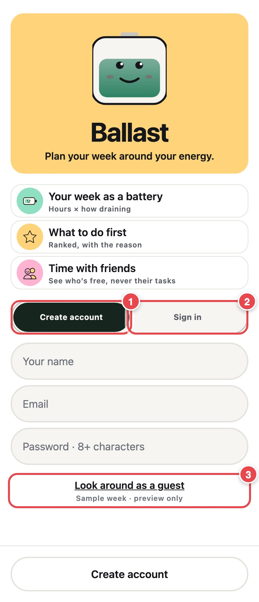</td>
<td>

**Welcome**

1. **Create account**: name, email, password. That's it.
2. **Sign in**: use a judge account from the table above.
3. **Look around as a guest**: only on our preview link, for a quick look without an account.

</td>
</tr>
<tr>
<td>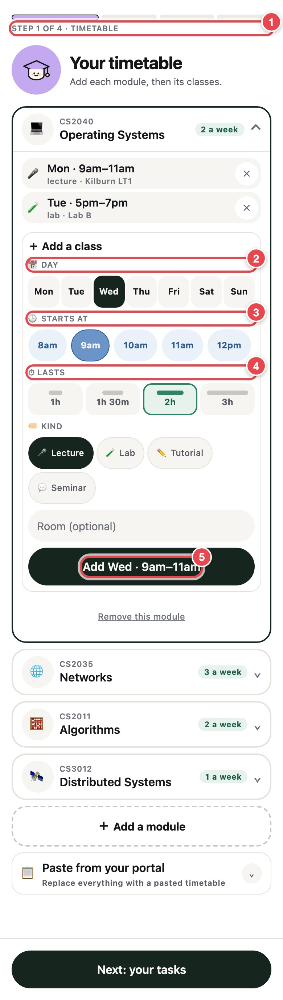</td>
<td>

**Setup, step 1: your timetable**

1. **Four short steps**, and you can skip any of them.
2. **Day**, **starts at** and **lasts**: one tap each, per class.
3. **Add**: it repeats every week. **Paste from your portal** imports a whole timetable at once.

</td>
</tr>
<tr>
<td>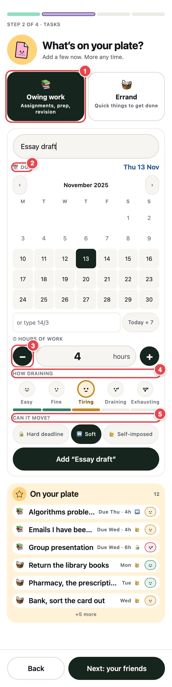</td>
<td>

**Setup, step 2: what's on your plate**

1. **Owing work** (assignments, revision) or a quick **errand**.
2. **Due**: pick the day on the calendar, or type it (`14/11`).
3. **Hours**, and **how draining** it is. Each face shows what it will cost your battery.
4. **Can it move?** 📌 Fixed, 🔒 Hard deadline, ↔️ Soft or 🙋 Self-imposed. **How important?** 🍃 Optional to 🔥 Must. Fixed things and hard deadlines are never suggested for moving.

</td>
</tr>
</table>

### 2. Home: your whole week, in one look

<table>
<tr>
<td width="300">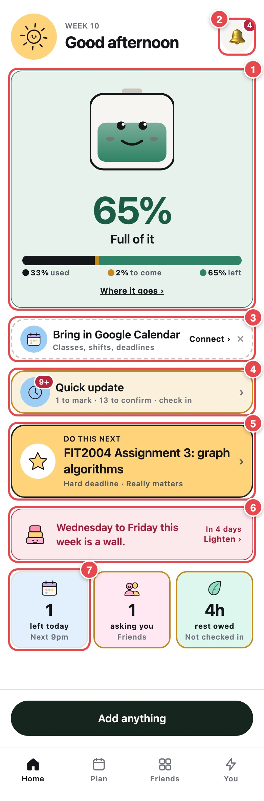</td>
<td>

1. **Your battery.** 100% on Monday, and every commitment takes its share: *used*, *to come* and *left*. Tap it to see where it goes.
2. **🔔 The bell.** Invitations, deadlines, and friends who said yes.
3. **Google Calendar.** Bring your events in (section 8).
4. **Quick update.** Everything waiting on a tap from you.
5. **Do this next.** The most important thing, with the reason.
6. **The wall.** A pile-up spotted *days* before it hits. Tap **Lighten** to fix it.

</td>
</tr>
<tr>
<td>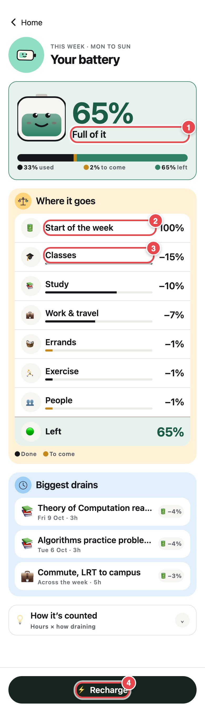</td>
<td>

**Where your battery goes**

1. Every week starts at **100%**.
2. Each kind of thing takes its share: classes, study, work, people, errands.
3. Rest and good sleep **give some back**. **Recharge** goes straight to things that refill it.

</td>
</tr>
</table>

### 3. Keeping it true: Quick update and notifications

<table>
<tr>
<td width="300">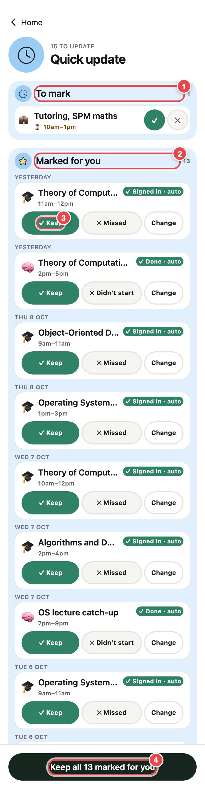</td>
<td>

1. **To mark**: everything whose time has just passed, **✓ or ✕** with one tap. Classes count towards attendance; done work moves its progress bar.
2. **How today feels** and **sleep**: each answer shows what it does to your battery.

*Forgot to mark something? The next morning Ballast assumes it happened and lists it under **Marked for you**, to keep or change.*

</td>
</tr>
<tr>
<td>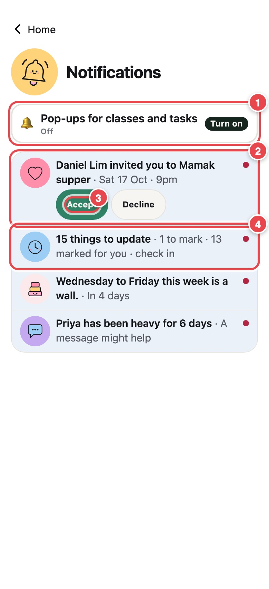</td>
<td>

1. **Pop-ups**: opt in, and Ballast nudges you when a class ends while the app is open in the background.
2. **Invitations** from friends and groups, answered **right here**.
3. Everything else worth knowing: who said yes, a plan ready for your week, a plan called off, a friend having a hard week. Each opens where you deal with it.

</td>
</tr>
</table>

### 4. Plan: the next 14 days

<table>
<tr>
<td width="300">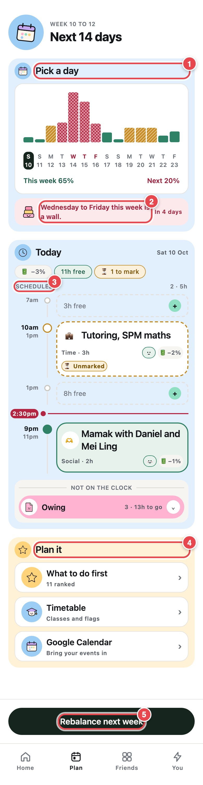</td>
<td>

1. **14 days at a glance.** Tall, patterned bars are heavy days. Tap one to open it.
2. **The wall**, flagged next to the days it's about.
3. **The day itself.** Every block shows its battery cost. Tap a free gap to add something there, or a block to mark it.
4. **Plan it**: *What to do first*, your *Timetable* and *Google Calendar*.

</td>
</tr>
<tr>
<td>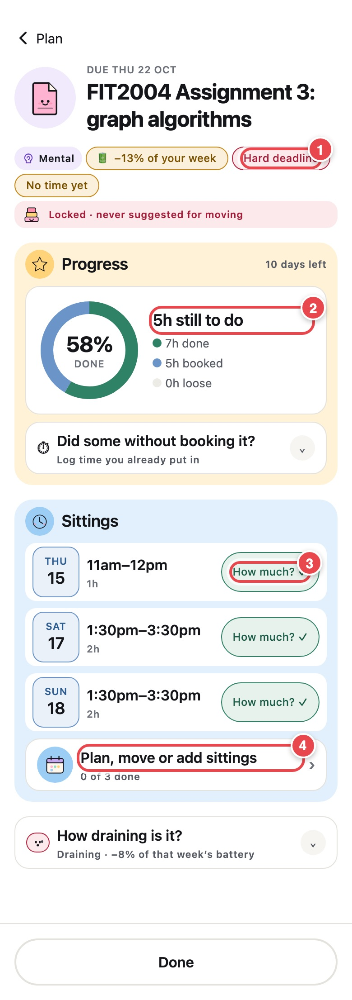</td>
<td>

**A piece of work**

1. Its area, its **battery cost**, and whether it can move. Hard deadlines are **locked**.
2. **Progress**: done, booked into your week, and still loose.
3. **Booked sittings.** When one ends, **How much? ✓** says how far you got.
4. **Plan, move or add sittings.** With hours still loose, **✨ Suggest** splits them onto your lightest days. **🗑 Cancel** sits beside **Done**, behind a second "Yes, cancel it".

</td>
</tr>
<tr>
<td>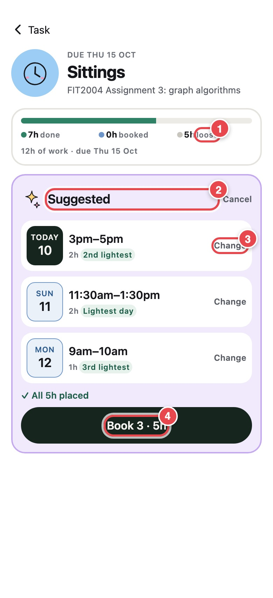</td>
<td>

**Booking the sittings**

1. One bar shows **done · booked · loose**.
2. **Booked**: every sitting, with its battery cost.
3. **⋯** to move one or give it back. **Push today's to tomorrow** when today falls apart.

</td>
</tr>
<tr>
<td>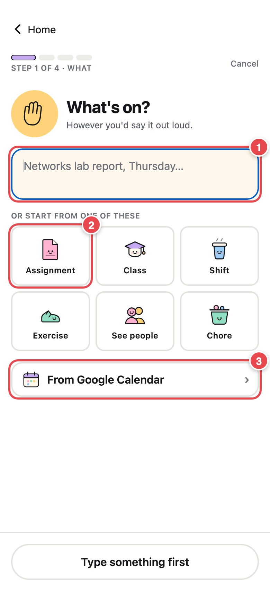</td>
<td>

**Add anything**

1. **Type it how you'd say it**: *"Networks lab report, Thursday, 5h, dreading it"*. Ballast picks out the day, the hours and the dread.
2. Or start from a **quick pick**, or bring it in **from Google Calendar**.

*Every time you pick a time, it's the same picker: this week and next with how full each day is (or a calendar for later dates), then drag the block along the day. 🟧 Amber blocks are things you could give up: slide onto one to take its place, and Ballast asks where it goes next.*

</td>
</tr>
<tr>
<td>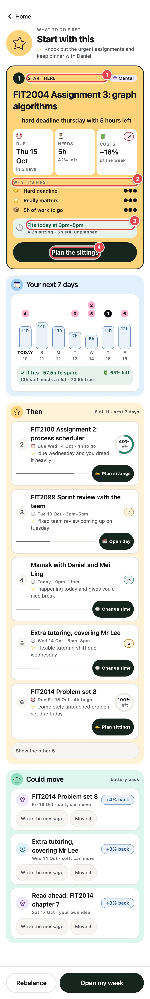</td>
<td>

**What to do first**

1. **Start here**: due, needs and costs, and the next time it fits.
2. **Why first**: the real reasons, each with 1–3 strength dots: 🚨 Short on time · ⏰ Due Wed · 3h free till then · 🤝 Hard deadline.
3. **Next 7 days**: free hours per day, and one bar of hours needed against hours free.
4. **Then**: owing work and tasks without a set time, most urgent first, the rank coloured by how soon each has to start.
5. **Could move**: flexible blocks your priorities can take over, least important first, each saying what it frees and which task could use it (⏱ Frees 2h · 🎯 For FIT2100 Assignment 2).
6. **Move it**: pick what takes the time (the 🎯 one first, and only things due after it), plan it in, then give the block a new time or drop it.

</td>
</tr>
</table>

### 5. ⚖️ Lighten: trading, not deleting

<table>
<tr>
<td width="300">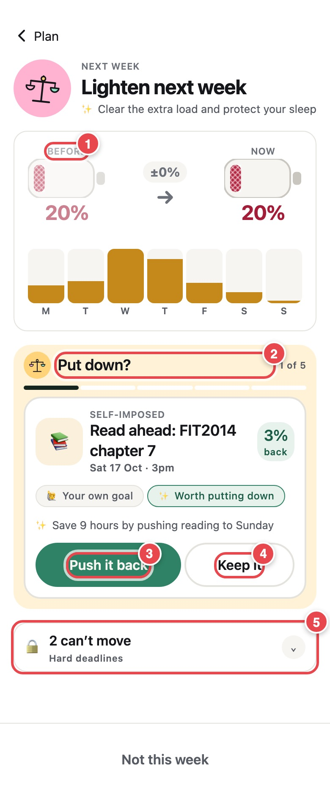</td>
<td>

1. **Before → now**: the battery of the week with the wall in it, and its 7 days, updating as you decide.
2. **One decision at a time**: what it is, what it gives back, and an ✨ AI opinion with its reason.
3. **Push it back**, **Hand it over** or **Put it down**. If someone is waiting on it, Ballast offers to **write to them first**; one confirm step says exactly what will happen.
4. **Hard deadlines** are listed but **never offered**.

</td>
</tr>
</table>

### 6. Recharge

<table>
<tr>
<td width="300">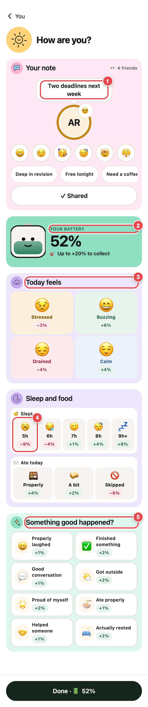</td>
<td>

**Check in: 20 seconds a day**

1. **Your note**: an emoji and a few words your friends see.
2. **How today feels**, **sleep**, and **something good**: every answer shows its effect, + or −.

</td>
</tr>
<tr>
<td>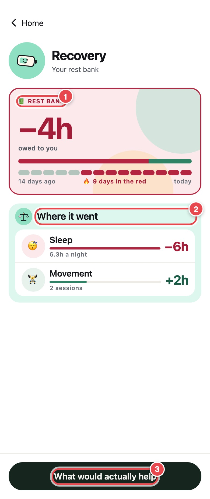</td>
<td>

**Recovery**

1. **The rest bank**: the rest you're owed after short sleeps and long days, line by line.
2. **What would actually help**: free ideas that fit your real gaps. Pick one, see what it gives back, and book it.

</td>
</tr>
</table>

### 7. 👥 Friends: share your free time, never your tasks

<table>
<tr>
<td width="300">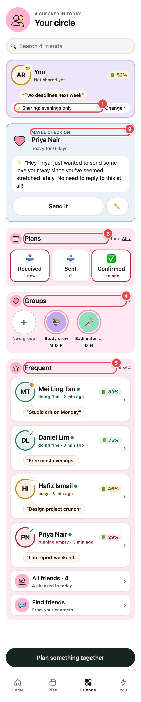</td>
<td>

1. **You**: your battery, your note, and how much you share.
2. **Maybe check on…**: a friend who's been heavy for days, with a kind message ✨ written for you.
3. **Plans** (received, sent, confirmed) and **groups**.
4. Each friend's battery and note at a glance. Tap one for their page and the evenings they chose to share.

</td>
</tr>
<tr>
<td>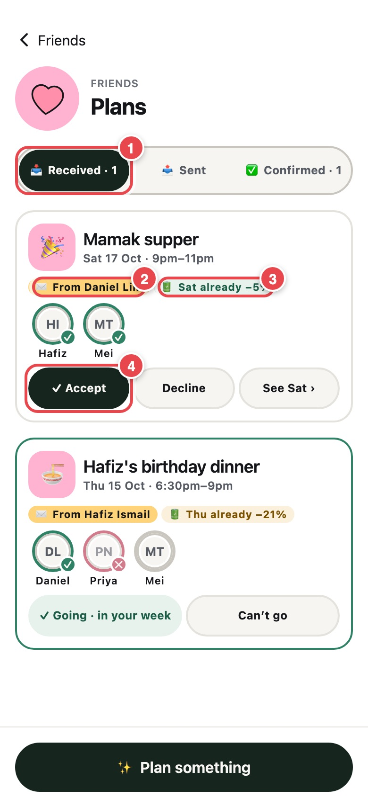</td>
<td>

**Plans**

1. Who's asking, who else is going, and **how full that day already is** before you say yes.
2. **Accept** puts it in your week as a 📌 fixed plan, on every device. If the host moves it, it moves; if they call it off, it leaves and you're told.
3. **Confirmed**: 🎉 everyone's in. If someone can't make it, **Go ahead** with whoever's coming.

</td>
</tr>
<tr>
<td>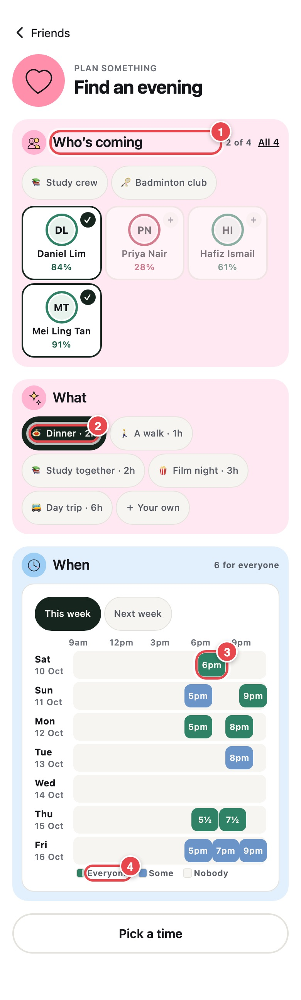</td>
<td>

**Find an evening for everyone**

1. **Who's coming**: tap faces, or a whole group.
2. **What**: the activity sets the length (dinner 2h, a film 3h).
3. **🟩 Green blocks are times everyone is free**, blue are times some are. If nothing suits everyone this week, it opens on next week. Tap one and send.

</td>
</tr>
</table>

### 8. 📅 Google Calendar and settings

<table>
<tr>
<td width="300">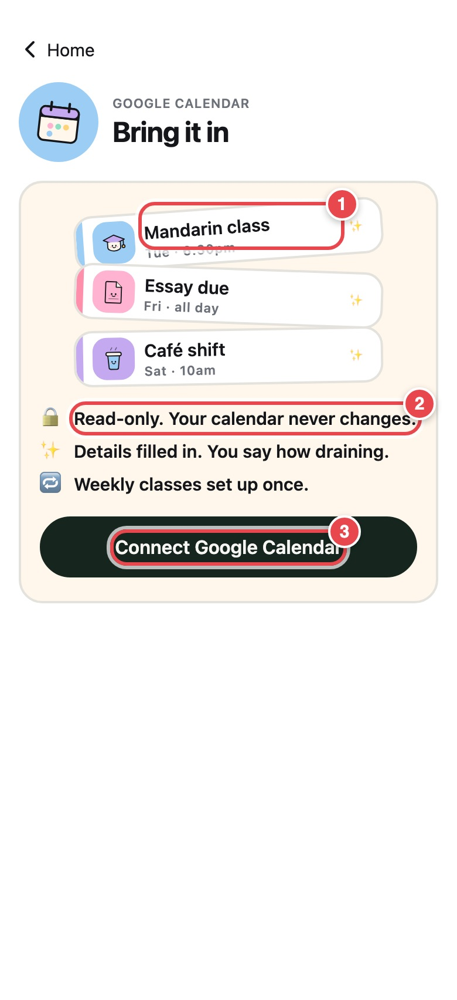</td>
<td>

1. Your events become cards, and Ballast **guesses what each one is**: class, deadline, shift, dinner.
2. **Read-only**: Ballast never changes your calendar, and events aren't stored on the server.
3. Set each one up like *Add anything*, details filled in. **Weekly classes are set up once.**

*Google shows an "unverified app" screen while verification is pending: tap **Advanced → Go to Ballast**. Please use your own account for this, not a judge account.*

</td>
</tr>
<tr>
<td>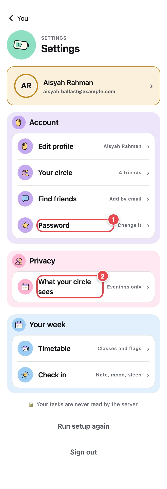</td>
<td>

1. **Password** (on your own account, please).
2. **What your circle sees**: how much of your free time friends see, or none at all, and hide it from anyone in particular.

</td>
</tr>
</table>

---

## ✨ What makes Ballast different

- **Energy, not hours.** Ballast prices each thing by how draining *you* say it is.
- **It sees the wall coming.** A pile-up of deadlines, days ahead, not the night before.
- **It plans the way out.** Real trades, hard deadlines locked, rest protected, and the awkward message written for you.
- **Friends without surveillance.** Your battery, your note and the free time you choose to share. **Never your tasks.**
- **AI where it helps.** Gemini writes messages, reasons and recovery ideas. The battery, rankings and plans run on our own model, so the numbers are explainable and the same every time; if the AI is busy, the app writes the text itself.

---

## 🛠️ Built to be relied on

| | |
|---|---|
| ✅ **Tested** | **1,200+ automated checks on every push**: 907 behaviour checks that drive the real store through every button, 209 API checks against a real Postgres, 90 design-token checks and 22 model checks, plus 663 strings across 53 rendered pages. `deploy` refuses to publish if any fails. |
| 🔍 **Checked live** | Before release, every screen was crawled as all five judge accounts, and the key journeys were driven end to end across accounts (invites, groups, sync between two devices, AI drafts, calendar sign-in, swap, cancel, recovery): 0 script errors, 0 failed requests. |
| 📡 **Monitored** | A scheduled GitHub Action signs in like a judge and checks the API, database, app, demo, sync, friends and plans. A failure opens an issue; recovery closes it. |
| 🧯 **Nothing lost** | Unsent edits are kept on the device and go first on the next open, so a reload or a closed tab loses nothing. A broken screen shows *Something went wrong · Try again* and reports itself, with no personal data. |
| ⚡ **Fast** | Every tap updates on the phone first and syncs in the background. The splash covers the first sync, so you never see an empty week. |
| ♿ **Accessible** | Lighthouse accessibility **100**: screen-reader labels, AA contrast, 24-point tap targets, pinch zoom, reduced motion, and no meaning carried by colour alone. |
| 🚀 **Shipped with care** | CI on every push; releases in [CHANGELOG.md](CHANGELOG.md); one deploy command per half (below), automated by `deploy.yml` once its two tokens are set. |

---

## 🧱 Architecture

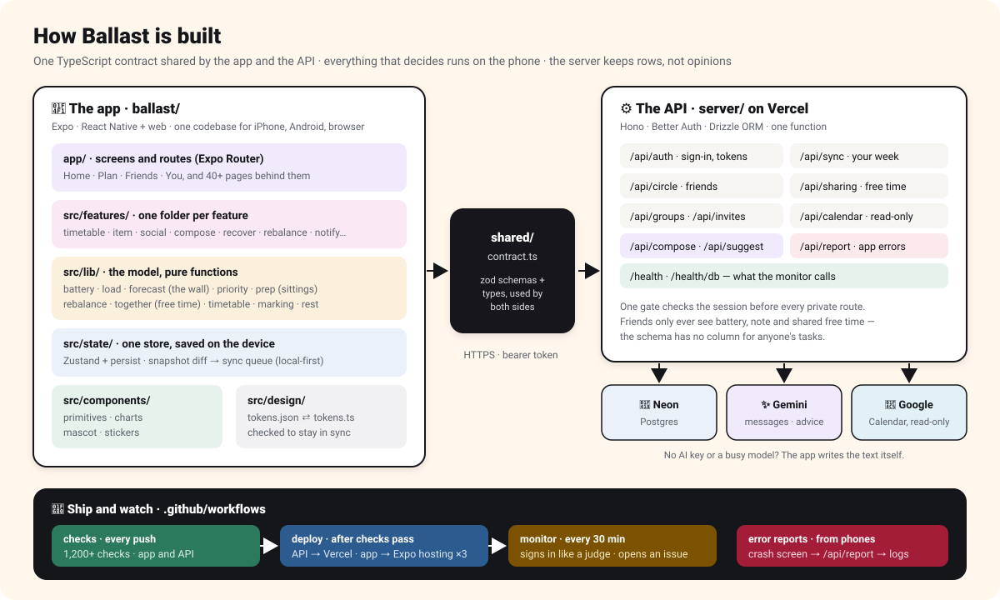

| Part | What it is | The boundary it keeps |
|---|---|---|
| `ballast/` | The app: Expo (React Native + web), Expo Router, Zustand. The battery, forecast, priorities, rebalancer and planner all run on the device. | The model in `src/lib/` is pure TypeScript with no React, so it's tested in plain Node. Only `lib/api.ts` touches the network. |
| `shared/` | The wire contract: zod schemas imported by both sides. | The API can't change shape under the app. |
| `server/` | The API: Hono on Vercel. Accounts (Better Auth, bearer tokens), sync, friends, groups, plans, Gemini, Google Calendar. | It keeps rows, not opinions: the schema has no column a friend could read your tasks from. |
| Neon Postgres | Accounts, synced documents, friendships, plans. | Drizzle schema; sync is last-write-wins per row. |
| `.github/workflows/` | `ci` · `deploy` · `monitor` · `judges` | Nothing deploys on red. |

**Tech stack:** Expo SDK 57 (React Native + web) · TypeScript (strict) · Expo Router · Zustand · NativeWind · Node.js + Hono on Vercel · PostgreSQL on Neon + Drizzle · Better Auth · Zod · Google Gemini API · Google Calendar API · GitHub Actions.

How the app is built, and the model in one page: **[ballast/README.md](ballast/README.md)**.

---

## 💻 Run it yourself

```bash
npm run setup          # install everything
npm run dev:api        # the API, on a local Postgres file
npm run dev:app        # the app
npm run check          # every check: types, tokens, model, behaviour, render, API
node scripts/monitor.mjs               # the live checks
npm --prefix ballast run judges:seed   # rebuild the five judge accounts around today
```

Deploying, with the exact commands for the three links: [ballast/README.md → Live links and deploying](ballast/README.md#live-links-and-deploying).

---

## 🛟 If something looks off

| Problem | Fix |
|---|---|
| Numbers look out of date | Reload. Your week syncs in seconds, friends' updates within a minute. |
| A judge account isn't as described here | Another judge may have changed it. It's rebuilt around the current week before judging. |
| The demo looks different from a judge account | The demo is a separate sample student, and it resets on every reload. |
| Google shows "unverified app" | Expected while Google reviews us: **Advanced → Go to Ballast**. |
| An ✨ AI line looks plainer than usual | Gemini was busy, so Ballast wrote it itself. Nothing is broken. |
| "Something went wrong" | Tap **Try again**. It has already been reported to us. |

---

## 📚 More

- [ballast/README.md](ballast/README.md): the developer guide (architecture, the model, design system, accessibility, verification).
- [docs/engineering-notes.md](docs/engineering-notes.md): the design journal, decision by decision.
- [CHANGELOG.md](CHANGELOG.md): what changed, by release.
- [README-idea.md](README-idea.md): the round-1 submission (the idea, research and prototype).

Contact: **kcchung82@gmail.com** · [Privacy policy](https://ballast-ckc3.vercel.app/privacy.html)
