# 🔋 Ballast

[](https://github.com/kinchung99/Workload_Balancer/actions/workflows/ci.yml)
[](https://github.com/kinchung99/Workload_Balancer/actions/workflows/monitor.yml)


**Plan your week by how much it takes out of you, not how many hours it fills.**

Most planners count hours. Ballast counts *energy*. Every class, deadline, shift and dinner costs a little of your battery, so you can see a bad week coming before it lands, and you get a plan for getting through it.

| | Link | What it is |
|---|---|---|
| 📱 **The app** | **https://load-balancer-ballast.expo.app** | The real app. Sign in with a judge account below. |
| 🎮 **Instant demo** | **https://load-balancer-ballast--demo.expo.app** | No login. Opens on a sample student's week, and **resets every time you reload**, so you can't break it. |
| 📄 **Quick guide (PDF)** | [docs/Ballast-Judges-Guide.pdf](docs/Ballast-Judges-Guide.pdf) | 12 pages: install, accounts, the key features, and known issues. |

---

## 📲 Install it on your phone (30 seconds, no App Store)

Ballast installs straight from the link. It gets a home-screen icon and opens full screen with no browser bar, like any other app.

**iPhone / iPad**
1. Open **https://load-balancer-ballast.expo.app** in **Safari**.
2. Tap the **Share** button <kbd>⬆︎</kbd> at the bottom of the screen.
3. Scroll down, tap **Add to Home Screen**, then **Add**.
4. Open **Ballast** from your home screen and sign in.

**Android**
1. Open **https://load-balancer-ballast.expo.app** in **Chrome**.
2. Tap the menu <kbd>⋮</kbd> (top right), then **Install app** (or **Add to Home screen**).
3. Tap **Install**, then open **Ballast** from your home screen and sign in.

> 💡 You can also use it in any desktop browser. It's designed for a phone, so it looks best in a narrow window.

---

## 🔑 Judge accounts

Five real accounts on the live app. They're Monash Malaysia students with a real timetable, coursework, shifts, moods and plans, and every day is planned: study sessions booked for each assignment, plus lunches, the gym, society meetings and downtime. **They're all friends with each other.** Sign in as two of them on two phones (or a phone and a laptop), and invitations, answers and batteries pass between them within a minute.

*Battery numbers below are from Mon 12 Oct. They move as the week goes, just as a real week would.*

**Password for all five: `BallastDemo2026`**

| Student | Email | Their week | Try this as them |
|---|---|---|---|
| 💻 **Aisyah Rahman**<br>Computer Science, Y2 | `aisyah.ballast@example.com` | 52% this week, but **next week is a wall**: two assignments and a birthday dinner, Wednesday to Friday | Tap the red **wall** warning, then **Lighten next week**. Answer Daniel's **Mamak supper** invite. Add the confirmed **Study session** to your week. |
| 🧪 **Priya Nair**<br>Biomedical Science, Y2 | `priya.ballast@example.com` | **29%, running on empty**: lab report due, 5.8h of sleep, heavy for 6 days | **Check in**, then open **Recovery** to book something that helps. Her friends get a nudge to check on her. |
| 📊 **Daniel Lim**<br>Business, Y3 | `daniel.ballast@example.com` | 75%, steady, barista shifts | Open **Plans → Sent**: see who has said yes to his Mamak supper. **Plan something** with Mei Ling: Thursday evening lights up green. |
| 🏗️ **Hafiz Ismail**<br>Civil Engineering, Y3 | `hafiz.ballast@example.com` | 46%, design project crunch | His **birthday dinner** plan has every kind of answer: yes, no, and still waiting. |
| 🎨 **Mei Ling Tan**<br>Communication Design, Y1 | `meiling.ballast@example.com` | 83%, the calm one | Answer the **Badminton club** group invitation and Priya's **Movie night** from the 🔔 bell. |

> [!WARNING]
> **These accounts are shared by every judge. Please play, but don't wreck them.**
> ✅ Go ahead: add tasks, mark classes, check in, book sittings, accept or decline plans, send invites, rebalance.
> 🚫 Please don't: **change the password**, **sign out other devices**, **delete groups**, **remove friends**, or **connect your own Google Calendar** to these accounts.
> If something does get messed up, we can rebuild all five in about a minute.

Want a blank slate instead? **Create your own account** on the same link and go through setup yourself (step 1 below). Add a judge account as a friend by email to see the social side from both ends.

---

## ⏱️ The 3-minute tour

1. Sign in as **Aisyah** and look at **Home**: one battery, one next thing, one warning.
2. Tap the red **"…is a wall"** card, then **Lighten next week**. Take things off one at a time; for anything involving someone else, it offers to write the message first.
3. Open **Plan** and tap a day: see the hours, and the battery each block costs.
4. Go to **Friends** and tap **Priya** (28%). Her week is heavy, her free evenings are shared, and **Text something** writes the message for you.
5. **Plan something together**: pick **Daniel** and **Mei Ling**, then **Dinner**. The **green block** (Thursday, 7pm) is when all three of you are free.
6. Tap the 🔔 **bell** and answer an invitation right there.

---

## 📖 Step-by-step guide

### 1. Getting started

<table>
<tr>
<td width="300">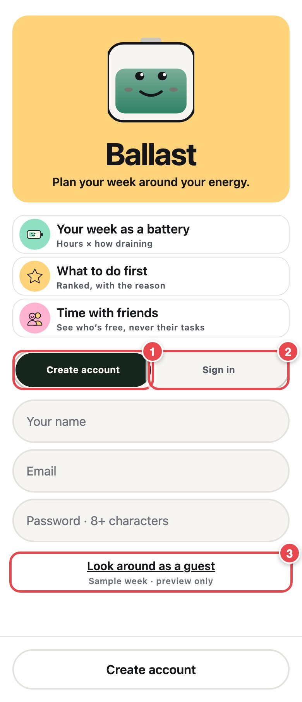</td>
<td>

**Welcome**

1. **Create account**: name, email, password. That's it.
2. **Sign in**: use a judge account from the table above.
3. **Look around as a guest**: only on our preview link, for a quick look without an account.

</td>
</tr>
<tr>
<td>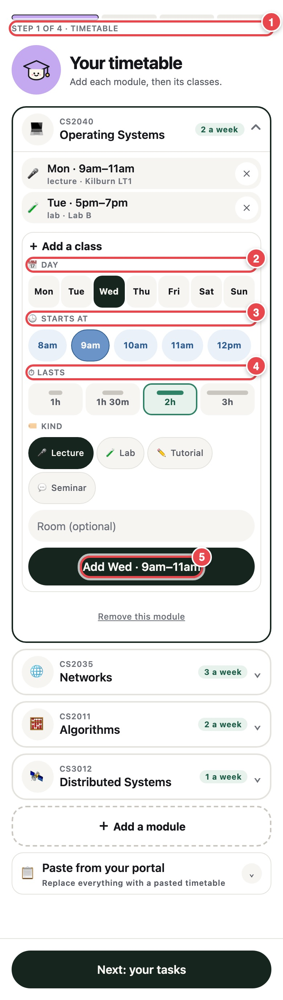</td>
<td>

**Setup, step 1: your timetable**

1. **Four short steps**, and you can skip any of them.
2. **Day**: one per class.
3. **Starts at**: tap a time.
4. **Lasts**: the bar shows how long the class is.
5. **Add**: it repeats every week. Studying from a portal? **Paste from your portal** imports the whole timetable at once.

</td>
</tr>
<tr>
<td>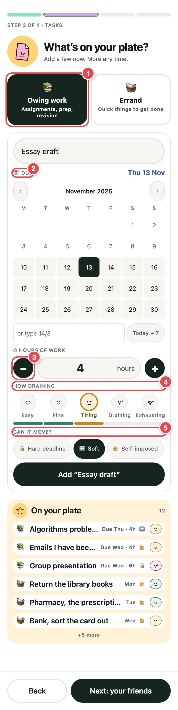</td>
<td>

**Setup, step 2: what's on your plate**

1. **Owing work** (assignments, revision) or a quick **errand**.
2. **Due**: pick the exact day on the calendar, or type it (`14/11`).
3. **Hours**: type them, or nudge with − / +.
4. **How draining?** Each face shows what it will cost your battery.
5. **Can it move?** 📌 Fixed, 🔒 Hard deadline, ↔️ Soft or 🙋 Self-imposed. **How important?** 🍃 Optional to 🔥 Must. Fixed things and hard deadlines are never suggested for moving.

</td>
</tr>
</table>

### 2. Home: your whole week, in one look

<table>
<tr>
<td width="300">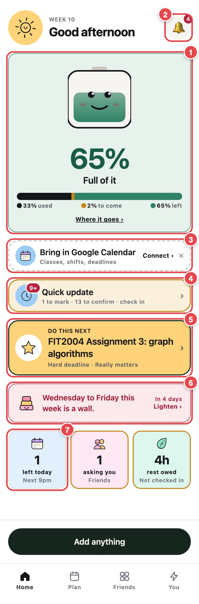</td>
<td>

1. **Your battery.** 100% on Monday, and every commitment takes its share. The bar splits it into *used*, *to come* and *left*. Tap it to see where it goes.
2. **🔔 The bell.** Invitations, deadlines, and friends who said yes.
3. **Google Calendar.** Bring your events in (see section 8).
4. **Quick update.** Everything waiting on a tap from you, with a count.
5. **Do this next.** One thing, the most important, with the reason.
6. **The wall.** A pile-up spotted *days* before it hits. Tap **Lighten** to fix it.
7. **At a glance.** Plan, Friends and You, one number each.

</td>
</tr>
<tr>
<td>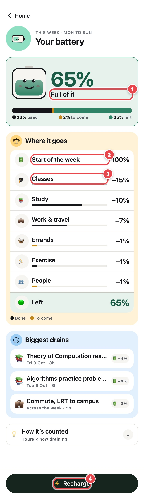</td>
<td>

**Where your battery goes**

1. How you're doing, in a word.
2. Every week starts at **100%**.
3. Then each kind of thing takes its share: classes, study, work, people, errands. Rest and good sleep **give some back**.
4. **Recharge** takes you straight to things that refill it.

</td>
</tr>
</table>

### 3. Keeping it true: Quick update and notifications

<table>
<tr>
<td width="300">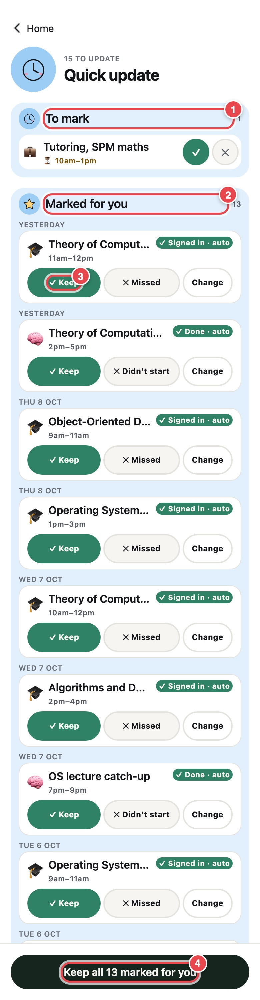</td>
<td>

1. **To mark**: everything whose time has just passed.
2. **✓ or ✕**, one tap each. Classes count towards attendance, and done work moves the progress bars forward.
3. **How today feels**: check in right here, and each answer shows what it does to your battery.
4. **Sleep**: short nights cost, good ones refill.

*Forgot to mark something? The next morning Ballast assumes it happened, and shows it under **Marked for you** to keep or change.*

</td>
</tr>
<tr>
<td>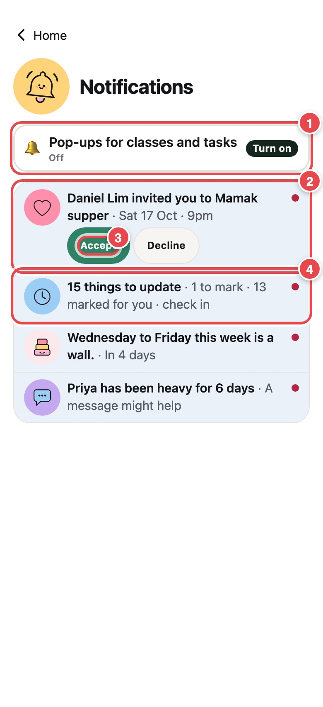</td>
<td>

1. **Pop-ups**: opt in, and Ballast nudges you when a class ends while the app is open in the background.
2. **Invitations** from friends and groups…
3. …answered **right here**.
4. Everything else worth knowing: who said yes to your plan, a plan that's ready for your week, a plan that was called off, deadlines, a friend having a hard week. Each one opens where you deal with it.

</td>
</tr>
</table>

### 4. Plan: the next 14 days

<table>
<tr>
<td width="300">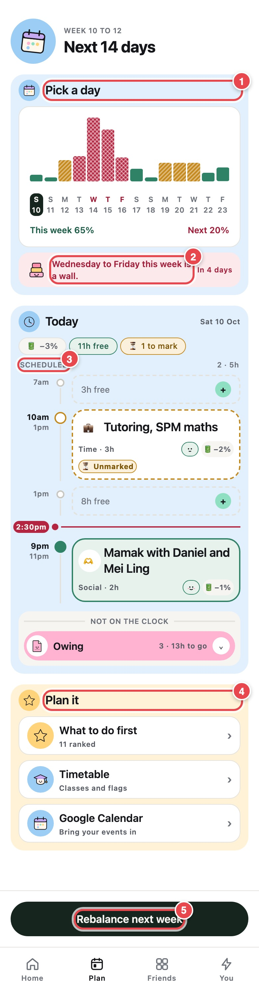</td>
<td>

1. **14 days at a glance.** Tall, patterned bars are heavy days. Tap a day to open it.
2. **The wall**, flagged next to the days it's about.
3. **The day itself.** Every block shows its battery cost. Tap a free gap to add something there, or a block to mark it.
4. **Plan it**: *What to do first*, your *Timetable* and *Google Calendar*.
5. **Rebalance next week** appears when a wall is coming.

</td>
</tr>
<tr>
<td>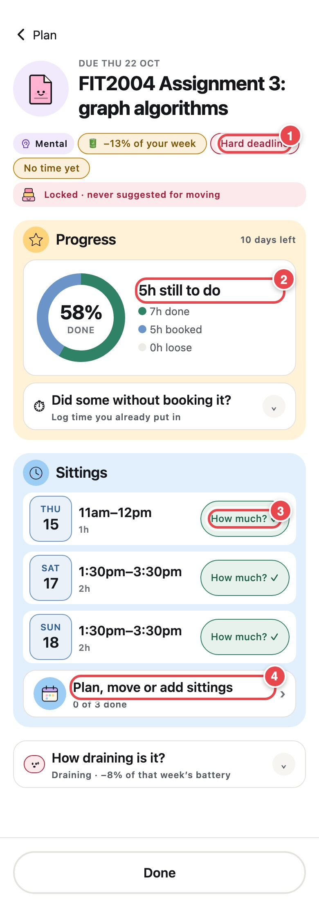</td>
<td>

**A piece of work**

1. Its area, its **battery cost**, and whether it can move. Hard deadlines are **locked**.
2. **Progress**: done, booked into your week, and still loose.
3. **Booked sittings.** When one ends, tap **How much? ✓** to say how far you got.
4. **Plan, move or add sittings.** With hours still loose, **✨ Suggest** splits them onto your lightest days.

</td>
</tr>
<tr>
<td>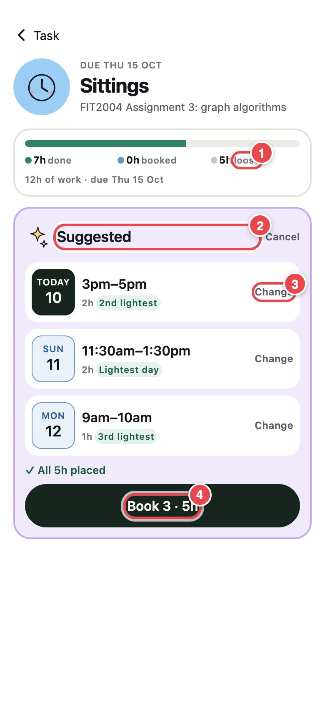</td>
<td>

**Booking the sittings**

1. One bar shows **done · booked · loose**.
2. **Booked**: every sitting, with its battery cost.
3. **⋯** to move one (any day this week or next) or give it back. **Push today's to tomorrow** when today falls apart.

*With hours still loose, **✨ Suggest** proposes sittings on your lightest days, each with its reason, and nothing is booked until you say so.*

</td>
</tr>
<tr>
<td>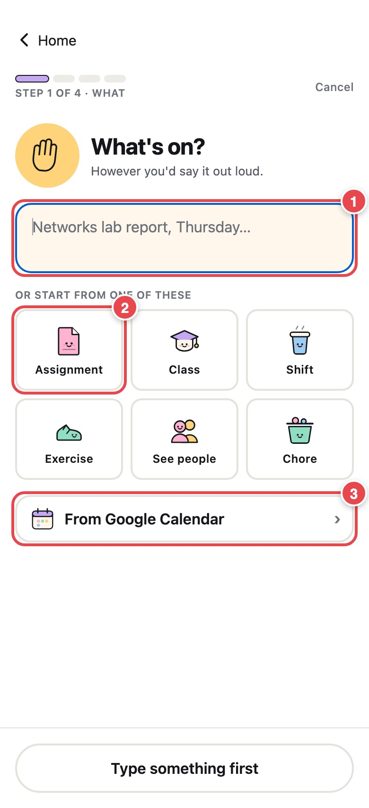</td>
<td>

**Add anything**

1. **Type it how you'd say it**: *"Networks lab report, Thursday, 5h, dreading it"*. Ballast picks out the day, the hours and the dread.
2. Or start from a **quick pick**.
3. Or bring it in **from Google Calendar**, details filled in.

</td>
</tr>
<tr>
<td>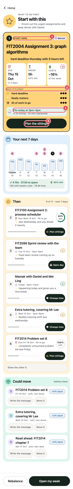</td>
<td>

**What to do first**

1. **Start here**: due date, hours needed, and what it costs.
2. **Why it's first**, in plain reasons.
3. **Your next 7 days**: how many hours the list needs against the free time you have.
4. **Then**: only owing work and tasks without a set time, in the order you have to **start** them. Heavy work due later rises above light work due sooner; importance decides within a day. Booked work shows its next sitting.
5. **Could move**: blocks at a set time that you're allowed to move, least important first, each with why and a lighter slot it fits. **Move it** opens the day-and-time picker right there. Fixed plans and hard deadlines never appear.

*Every time you pick a time in Ballast, it's the same picker: this week and next with how full each day is (or a calendar for later dates), then drag the block along the day.*

</td>
</tr>
</table>

### 5. ⚖️ Lighten next week: trading, not deleting

<table>
<tr>
<td width="300">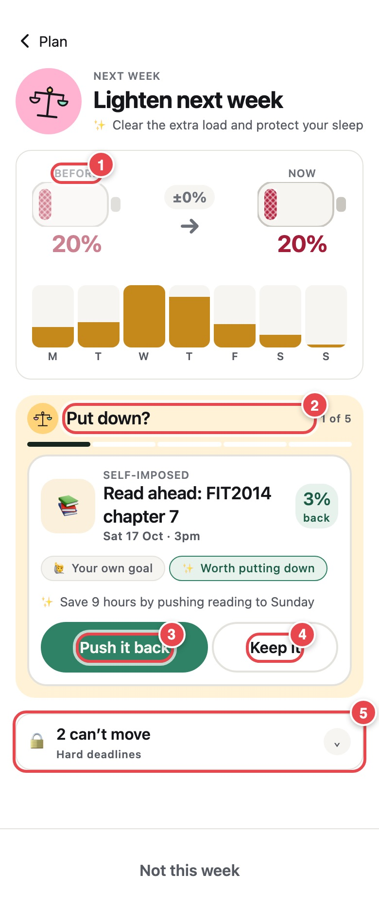</td>
<td>

1. **Before → now**: next week's battery, and the 7 days underneath, update as you decide.
2. **One decision at a time**: what it is, when it is, what it gives back, and an ✨ AI opinion with its reason.
3. **Push it back**, **Hand it over**, or **Put it down**. If someone is waiting on it (a friend, a manager, a lecturer), Ballast offers to **write to them first**. Then one confirm step says exactly what will happen.
4. **Keep it**, and move on.
5. **Hard deadlines** are listed but **never offered**.

</td>
</tr>
</table>

### 6. Recharge

<table>
<tr>
<td width="300">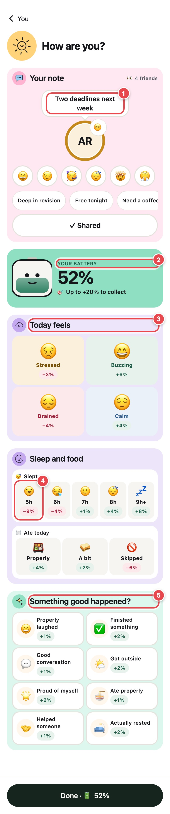</td>
<td>

**Check in: 20 seconds a day**

1. **Your note**: an emoji and a few words your friends see.
2. **Your battery**, and how much a good check-in could give back.
3. **How today feels**: every answer shows its effect, + or −.
4. **Sleep**: short nights cost, good ones refill.
5. **Something good happened?** Small wins count too.

</td>
</tr>
<tr>
<td>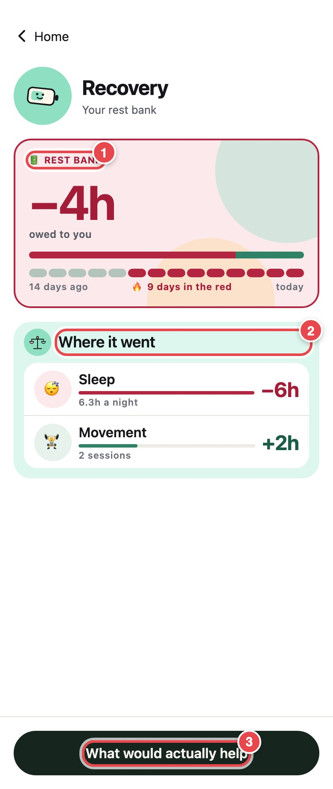</td>
<td>

**Recovery**

1. **The rest bank**: the rest you're owed after short sleeps and long days.
2. **Where it went**, line by line.
3. **What would actually help**: free ideas that fit your actual gaps, one tap to book.

</td>
</tr>
</table>

### 7. 👥 Friends: share your free time, never your tasks

<table>
<tr>
<td width="300">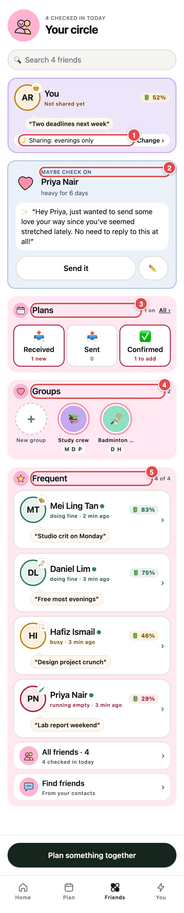</td>
<td>

1. **You**: your battery, your note, and how much you share.
2. **Maybe check on…**: a friend who has been heavy for days, with a kind message ✨ written for you.
3. **Plans**: Received, Sent and Confirmed.
4. **Groups**: your regular people.
5. **Frequent**: each friend's battery and note at a glance. Tap one to open their page.

</td>
</tr>
<tr>
<td>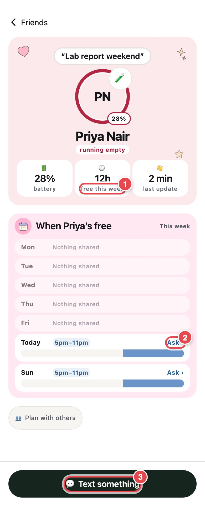</td>
<td>

**A friend's page**

1. Their battery, free hours and last update.
2. **The evenings they chose to share.** Tap **Ask** to suggest that one.
3. **💬 Text something** writes the message for you.

</td>
</tr>
<tr>
<td>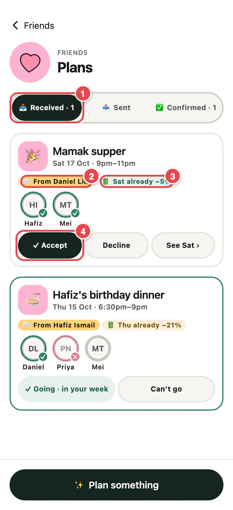</td>
<td>

**Plans you've been invited to**

1. **Received · Sent · Confirmed**.
2. Who's asking, and who else is going (✓ or ✕ on their faces).
3. **How full that day already is**, before you say yes.
4. **Accept**, **Decline**, or **See** that day. **Accept** puts it in your week as a 📌 fixed plan, on every device you use. If the host moves it, it moves; if they call it off, it leaves and you're told.

</td>
</tr>
<tr>
<td>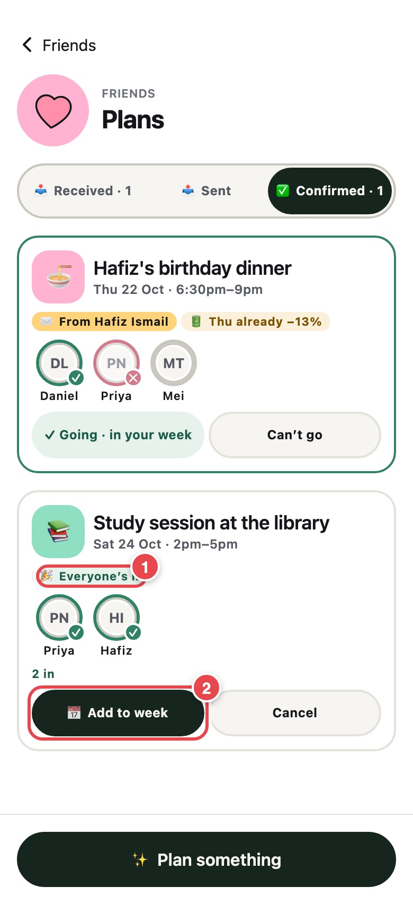</td>
<td>

**Confirmed**

1. 🎉 **Everyone's in**: every plan you're going to, yours and the ones you said yes to.
2. **Add to week** once everyone has answered. If someone can't make it, **Go ahead with 2** keeps the plan with whoever's coming.

</td>
</tr>
<tr>
<td>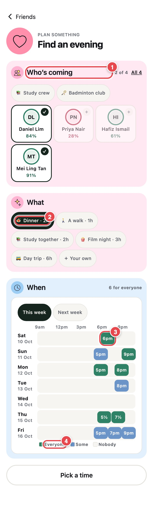</td>
<td>

**Find an evening for everyone**

1. **Who's coming**: tap faces, or a whole group.
2. **What**: the activity sets the length (dinner is 2h, a film is 3h).
3. **🟩 Green blocks are times everyone is free**, and blue blocks are times some of them are, each the length of the plan. Tap one.
4. Send it, and the answers arrive in **Plans** and the 🔔 bell.

</td>
</tr>
</table>

### 8. 📅 Google Calendar and settings

<table>
<tr>
<td width="300">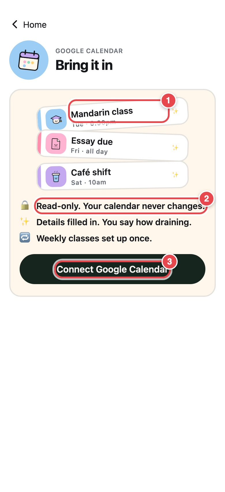</td>
<td>

1. Your events become cards, and Ballast **guesses what each one is**: class, deadline, shift, dinner…
2. **Read-only**: Ballast never changes your calendar.
3. **Connect**, then set each one up like *Add anything* with the details filled in. **Weekly classes are set up once.** If Google moves an event, it moves here too.

*Google shows an "unverified app" screen while our verification is pending. Tap **Advanced → Go to Ballast**. (Please use your own account for this, not a judge account.)*

</td>
</tr>
<tr>
<td>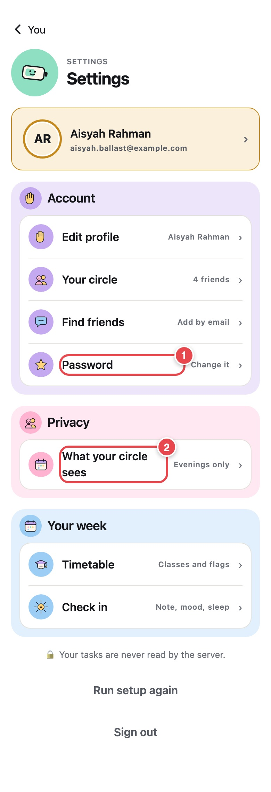</td>
<td>

1. **Password**: change it (on your own account, please, not the judge ones).
2. **What your circle sees**: choose how much of your free time friends see, or none at all, and hide it from anyone in particular.

</td>
</tr>
</table>

---

## ✨ What makes Ballast different

- **Energy, not hours.** Two hours of a dreaded lab report and two hours of badminton are not the same two hours. Ballast prices each thing by how draining *you* say it is.
- **It sees the wall coming.** It spots a pile-up of deadlines days ahead, not the night before.
- **It plans the way out.** Lighten next week is a list of real trades. Hard deadlines stay locked, rest stays protected, and the awkward message gets written for you.
- **Friends without surveillance.** Friends see your battery, your note and the free time you choose to share. **Never your tasks.**
- **AI where it helps, not where it shows off.** Message drafts, reasons and recovery ideas come from Google's Gemini model. The battery, rankings and plans run on our own model, so the numbers are explainable and stay the same each time.
- **Private by design.** Your week syncs across devices, but its contents are never analysed on the server. Google Calendar is read-only and events are never stored.

---

## 🛟 If something looks off

| Problem | Fix |
|---|---|
| Can't stay signed in on iPhone | Fixed. Close the tab, reopen the link, and sign in again. |
| Numbers look out of date | Reload the page. Your week syncs in seconds, and friends' updates within a minute. |
| The demo looks different from a judge account | The demo is a separate sample student, and it resets on every reload. |
| Google shows "unverified app" | Expected while Google reviews us. Tap **Advanced → Go to Ballast**. |
| An ✨ AI line looks plainer than usual | Gemini's free tier was busy, so Ballast wrote it itself. Nothing is broken. |
| "Something went wrong" | Tap **Try again**. It has already been reported to us automatically. |

Contact: **kcchung82@gmail.com** · [Privacy policy](https://ballast-ckc3.vercel.app/privacy.html)

---

## 🛠️ Built to be relied on

| | |
|---|---|
| ✅ **Tested** | **1,100+ automated checks** on every push: 900+ for the app (the battery model, behaviours, every page rendered) and 200+ for the API against a real Postgres. CI must be green before anything deploys. |
| 📡 **Monitored** | Every 30 minutes a GitHub Action signs in like a judge and checks the API, the database, the app, the demo, sync, friends and plans. A failure opens an issue; recovery closes it. |
| 🧯 **Crash-safe** | A screen that breaks shows *"Something went wrong · Try again"* instead of a blank page, and reports itself to the API's logs, with no personal data. |
| ♿ **Accessible** | Lighthouse accessibility **100** on all 24 screens tested: labels for screen readers, AA contrast, 24-point tap targets, pinch zoom allowed, reduced motion respected. |
| ⚡ **Fast** | Local-first: your week is saved on the phone, so every tap updates instantly and syncs in the background. Almost no layout shift on load, and Lighthouse best practices **100** (clean console, no third-party cookies). |
| 🚀 **Deployed by pipeline** | Push → checks → deploy (API to Vercel, app to Expo hosting) → live checks. |

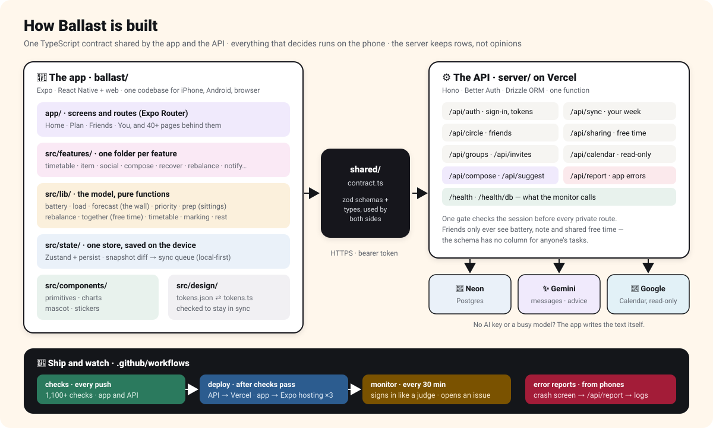

<details>
<summary><b>For developers</b></summary>

| | |
|---|---|
| `ballast/` | The app: Expo (React Native + web), Expo Router, Zustand. The battery model, forecast, rebalancer and planner all run on the device. |
| `server/` | The API: Hono on Vercel, Postgres on Neon, Better Auth (email + guest, bearer tokens), Gemini for writing, Google Calendar (read-only). |
| `shared/` | The wire contract (zod), used by both sides. |
| `scripts/` | `monitor.mjs`: the live checks the monitor workflow runs every 30 minutes. |
| `.github/workflows/` | `ci` (checks on every push), `deploy` (after checks pass), `monitor` (every 30 minutes). |
| `docs/` | Guide screenshots, the [PDF guide](docs/Ballast-Judges-Guide.pdf), the [architecture diagram](docs/architecture.svg), the [thumbnail](docs/Ballast-Thumbnail.pdf). |

How the app is built, decision by decision: [ballast/README.md](ballast/README.md). What changed: [CHANGELOG.md](CHANGELOG.md).

```bash
npm run setup          # install everything
npm run dev:api        # API on a local Postgres file, no accounts needed
npm run dev:app        # the app
npm run check          # every check: types, model, behaviour, render, API
node scripts/monitor.mjs               # the live checks the monitor runs every 30 minutes
npm --prefix ballast run judges:seed   # rebuild the five judge accounts around today's date
```

Automatic deploys need two repository secrets: `EXPO_TOKEN` (app) and `VERCEL_TOKEN` (API). Until they're set, each half of the deploy workflow skips itself with a note. Changes are listed in [CHANGELOG.md](CHANGELOG.md).

</details>
