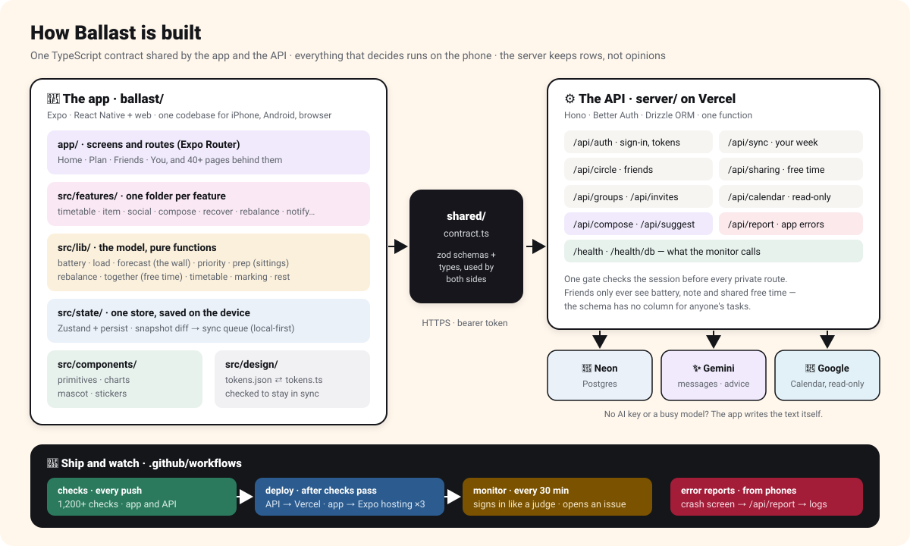

# Ballast — the app

The developer guide. For what Ballast does and how to try it, start at the
[top-level README](../README.md); for the design journal behind it, see
[docs/engineering-notes.md](../docs/engineering-notes.md).

React Native through Expo: one codebase for iPhone, Android and the web.
Everything that *decides* — the battery, the forecast, the priority list, the
rebalancer, the planner — runs on the phone. The API in `../server` keeps
accounts, syncs a week between devices, and carries what friends can see of each
other; it never computes anything about anyone's week.

```
Load Balancer/
├── README.md        ← the judges' guide: links, accounts, a tour of every feature
├── CHANGELOG.md     ← what changed, by release
├── ballast/         ← the app (this folder)
├── server/          ← the API: Hono on Vercel, Neon Postgres, Better Auth
├── shared/          ← contract.ts: the zod schemas both sides import
├── api/             ← the Vercel entry point for server/
├── scripts/         ← monitor.mjs: the live checks
├── .github/         ← checks · deploy · monitor · judges (rebuild the judge accounts)
└── docs/            ← guide screenshots, PDF guide, architecture diagram, engineering notes
```

---

## Quick start

```bash
npm install
npm run web         # in a browser
npm start           # or scan the QR code with Expo Go
```

With no `EXPO_PUBLIC_API_URL` the app runs on the sample week alone, offline,
with nothing to sign in to. Three build-time variables decide which app you get:

| Variable | Effect |
|---|---|
| `EXPO_PUBLIC_API_URL` | The API to talk to (`https://ballast-ckc3.vercel.app`). Without it: sample week only. |
| `EXPO_PUBLIC_GUEST=1` | Adds *Look around as a guest*. Preview only — production is sign-in only. |
| `EXPO_PUBLIC_DEMO=1` | With `GUEST`: opens straight on the sample week and resets it on every load. |

They are inlined at build time, so run `npx expo export --clear` after changing
them. The API runs locally with `npm run dev:api` from the repo root (a Postgres
file, no accounts needed).

---

## Live links and deploying

| Link | Build | For |
|---|---|---|
| https://load-balancer-ballast.expo.app | `API_URL` only | The real app. Sign-in only. |
| https://load-balancer-ballast--preview.expo.app | `+ GUEST=1` | The same, plus *Look around as a guest*. |
| https://load-balancer-ballast--demo.expo.app | `+ GUEST=1 DEMO=1` | Opens on the sample week; resets on reload. |

From this folder (`deploy` runs every check first and will not publish on red):

```bash
env -u EXPO_PUBLIC_GUEST -u EXPO_PUBLIC_DEMO EXPO_PUBLIC_API_URL=https://ballast-ckc3.vercel.app npm run deploy
EXPO_PUBLIC_API_URL=https://ballast-ckc3.vercel.app EXPO_PUBLIC_GUEST=1 npx expo export --platform web --clear && npx eas deploy --alias preview
EXPO_PUBLIC_API_URL=https://ballast-ckc3.vercel.app EXPO_PUBLIC_GUEST=1 EXPO_PUBLIC_DEMO=1 npx expo export --platform web --clear && npx eas deploy --alias demo
```

Set both flags together for the demo: `DEMO` without `GUEST` builds a sign-in
app with no sample week. An alias can keep serving the previous build for a
minute or two; compare the page's `entry-*.js` with the one in `dist/` before
calling it live. The EAS project is `@kc699/load-balancer-ballast`.

`.github/workflows/deploy.yml` does the same after the checks pass on `main`,
API first, once the repository has `EXPO_TOKEN` and `VERCEL_TOKEN` secrets;
without them each half skips itself with a note.

---

## Architecture



```
ballast/
├── app/                 Expo Router. One file per screen, nothing else.
│   ├── _layout.tsx      Root stack, session gate, sync loop, ErrorBoundary, splash
│   ├── +html.tsx        The HTML shell: boot cover, no hydration, iOS input size
│   ├── (tabs)/          Home · Plan · Friends · You
│   └── …                welcome, setup, add, item, priority, swap, rebalance, plans,
│                        plan-together, group, friend, checkin, recover, calendar…
├── src/
│   ├── design/          tokens.json (W3C DTCG) ⇄ tokens.ts, screens, families
│   ├── components/      primitives · charts · layout — no business logic
│   ├── features/        one folder per feature: item, social, recover, rebalance…
│   ├── lib/             the model, pure functions, no React
│   ├── state/           store.ts (Zustand), snapshot.ts (diff), sync.ts
│   ├── hooks/           useSync, useGate, useCalendarSync, usePopups…
│   └── data/            the sample week and the day filler
└── scripts/             the checks, screenshots, judges:seed
```

**One-directional dependencies:** `app/` → `features/` → `components/` →
`lib/` → `design/`. `lib/` imports no React, so the whole model is checked by a
plain Node script. Only `lib/api.ts` knows there is a network.

**Data flow.** A tap writes to the Zustand store and renders at once. `useSync`
diffs the syncable state against its last snapshot and pushes only what changed
to `/api/sync` (last write wins, per row), pulling everything newer in the same
call. Edits not yet sent are kept on the device for each account and go first
on the next open, and a page being closed pushes immediately, so nothing is lost
to a reload or a closed tab. After sign-in or a reload, the splash stays up until
the account's week and friends have arrived. Friends, groups and plans are
fetched, never synced: they are other people's data.

---

## The model, in one page

| | Rule | Where |
|---|---|---|
| **Load** | `hours × dread` (dread 1–5, asked once). Rest gives back: booked recovery is worth 8 load an hour. | `lib/load.ts` |
| **Battery** | Five areas (mental, time, errands, social, physical), each with a personal limit. Overall = total load ÷ total capacity; battery = 100 − that. Limits move after two hard days reported below the line. | `lib/load.ts`, `lib/battery.ts` |
| **The wall** | A 72-hour window slid across 14 days: four or more things of 9+ load, repeating background excluded. The densest window wins; it is named by calendar week. | `lib/forecast.ts` |
| **What to do first** | Owing work and tasks without a set time, sorted by the day each has to **start** (walk back from the deadline through free hours 9–9, at most 4 a day). Importance, promises and tightness decide within a day. | `lib/priority.ts` |
| **Could move** | Flexible blocks (own plans, soft ones) — never fixed plans, deadlines, classes or sittings. Least important first, each naming a task due after it that could use its time. | `lib/priority.ts`, `lib/replace.ts` |
| **Lighten** | Trades on the week with the wall in it: push your own, hand over, decline with a message, batch errands. Only worth-it trades (6+ load); hard deadlines and flagged classes listed, never offered; rest protected. | `lib/rebalance.ts` |
| **Sittings** | Owing work split into 30-minute to 2-hour sittings inside 9am–9pm, lightest days first. | `lib/prep.ts` |
| **Marking** | A block asks one question when it ends. Unanswered by the next morning, it is assumed done and kept to confirm. | `lib/marking.ts` |

---

## Tech stack

| Layer | Choice | Why this one |
|---|---|---|
| Runtime | **Expo SDK 57** / React Native 0.86 / React 19.2 | One codebase for a phone, a tablet and a browser; installs from a link. |
| Language | **TypeScript 6**, `strict` | Every domain concept — bucket, dread, commitment — is a union type, so an invalid week does not compile. |
| Routing | **Expo Router 57** (file-based) | The route tree *is* the screen inventory. Static export, rendered fresh on the client behind a loading cover. |
| Styling | **NativeWind 4** + Tailwind 3.4 | Tailwind's theme is generated from the design tokens, so a class name and a token are the same decision. |
| State | **Zustand 5** + persist | The model is small and synchronous. A snapshot diff feeds the sync queue; a guest's week and any unsent edits are kept on the device. |
| Sync & accounts | **Hono API** on Vercel, **Better Auth** | Bearer tokens (iPhone Safari drops cross-site cookies), `/api/sync` last-write-wins documents. See `../server`. |
| Database | **Neon Postgres** via Drizzle | Rows, not opinions: the schema has no column for a friend to read your tasks from. |
| Writing | **Gemini** through the API | Message drafts, ideas and one-line advice. Every call has a hand-written fallback on the phone. |
| Calendar | **Google Calendar**, read-only | Events become things to set up; nothing is written back or stored. |
| Charts | **Hand-built + react-native-svg** | Deliberately *not* a chart library — see below. |
| Animation | React Native `Animated` | Native driver on phones (`NATIVE_DRIVER`), JavaScript on the web. |

### A note on Expo Go and SDK versions

Expo Go 57 requires **iOS 16.4 or newer**. On an older device the App Store
serves an older Expo Go, which cannot open this project: use a development build
(`npx expo run:ios`, needs Xcode) or `npm run web`.

Two things bite when moving between SDK majors:

- `npx expo install --fix` can add `expo-status-bar` to `plugins` in `app.json`.
  It ships no config plugin and the export fails until you take it back out.
- `babel-preset-expo` is hoisted on 57 and not on 54. It is kept as an explicit
  devDependency here so the question never comes up again.

Also check `react` and `react-dom` match exactly after any change. A 19.2.8 /
19.2.3 split produces a minified React error #527 at static-render time and
nothing more useful.

### Why no chart library

The study specifies Victory Native. It was rejected for two reasons that both
matter more than the convenience:

1. **Figma.** A charting library renders to a canvas or an opaque SVG tree. A bar
   built from `<View>` and a `<Pattern>` arrives in Figma as a rectangle with a
   real fill, inside an auto-layout frame, with the label as editable text.
2. **Accessibility.** Every chart here carries a spoken sentence and a fill
   pattern, neither of which a chart library gives you without fighting it.

The five chart components total 343 lines and depend on nothing but `react-native-svg`.

---

## Screens

The four tabs and the pages behind them. Every one is reachable from a button,
and every non-tab page carries a labelled way back.

| Area | Routes | What they do |
|---|---|---|
| Start | `/welcome`, `/setup/[step]` | Sign up or in; timetable, tasks, friends, ready |
| Home | `/`, `/battery`, `/update`, `/marked`, `/notifications`, `/calm` | Battery, the wall, do this next, what to mark |
| Plan | `/plan`, `/add`, `/item/[id]`, `/item/[id]/sittings`, `/priority`, `/swap/[id]`, `/rebalance`, `/decline/[id]` | 14 days, capture, owing work, what first (sorted by start-by day, `lib/priority`), could move, swap a movable block for what matters more (`lib/replace`), lighten. Every time choice uses one picker (`features/item/SittingEditor`): two weeks with each day's load or a calendar, then a ribbon to drag along, with blocks you could give up in amber. Tasks cancel behind a confirm (`features/item/CancelTask`) |
| Timetable | `/timetable`, `/timetable/[step]`, `/module/[id]` | Week, modules, attendance, flags, paste import |
| Friends | `/friends`, `/everyone`, `/friend/[id]`, `/find-friends`, `/plans`, `/plan-together`, `/group/…`, `/message` | Circle, plans, groups, messages |
| You | `/you`, `/checkin`, `/recover`, `/prescription`, `/tonight/[step]`, `/profile`, `/settings`, `/sharing…`, `/calendar…`, `/password`, `/account` | Check in, rest, privacy, calendar, account |

Home switches into calm mode on its own past `threshold.calmMode`. `/calm`
renders it on demand, so it can be reviewed without making a week worse.

---

## Design system

`src/design/tokens.json` is the single source of truth — W3C DTCG format,
importable by Tokens Studio. Nothing else defines a value:

- `tailwind.config.js` parses it at config time, so Tailwind's theme *is* the
  token set. `theme`, not `theme.extend`: a class that is not a token does not
  exist. No `text-[13px]`, no `bg-[#fff]`, no arbitrary values.
- `src/design/tokens.ts` is the typed mirror for app code.
- `npm run tokens:check` walks both and fails on drift — 90 scalar tokens.

**Contrast was computed, not eyeballed, and then measured.** Muted text
(`ink.subtle`, `#5D626B`) clears 5:1 on every tinted wash, and the steady green
(`#2B7A5E`) carries off-white text at 4.8:1 — both darkened after a Lighthouse
pass found 4.3:1 on a few tinted cards. Where a bar cannot reach 3:1 against its
own track, the fill pattern and the number beside it carry the meaning.

---

## Accessibility

Tested against the study's own condition — a tired person, one-handed, on a bus,
at 11pm, with a cracked screen — and measured: **Lighthouse accessibility 100 on
every screen tested** (all 24 in a full pass, re-run after each fix).

- **Never colour alone.** Four bands, each carrying a colour *and* a word *and* a
  fill pattern — flat, diagonal hatch, cross hatch, vertical rule, drawn as SVG
  patterns. Print in greyscale and all four remain distinguishable.
- **Charts that can be spoken.** Every visualisation carries a sentence, not a
  label, and `render:check` asserts that sentence is in the output.
- **Contrast.** AA everywhere, including muted text on tinted cards (see
  *Design system*).
- **Targets.** 44pt on native controls; on the web nothing is under 24 points —
  the fourteen-day strip widens its section by a few points to keep that.
- **Names and roles.** Every page has a title; tab switchers are real tab lists;
  the strength dots on the priority page are announced as "2 of 3".
- **Zoom stays on.** Pinch zoom is allowed; on iPhone, fields use 16px text so
  Safari does not zoom in on its own when one is tapped.
- **Motion that can stop.** `useReducedMotion` is wired and respected.
- **Controls built, not installed.** The slider is draggable, tappable *and*
  `accessibilityRole="adjustable"` with increment/decrement actions.
- **One thumb.** Every primary action is in `Screen`'s `footer`, in the lower half.

---

## Verification

About 1,200 checks, all runnable without a device, all in CI:

| Check | Count | What it proves |
|---|---|---|
| `npm run typecheck` | strict | Every domain concept is a union type; an invalid week does not compile. |
| `scripts/verify-tokens.mjs` | 90 | `tokens.json` and `tokens.ts` have not drifted. |
| `scripts/check-model.mjs` | 22 | The load model reproduces the interface study's figures. |
| `scripts/check-behaviour.mjs` | 907 | The real store, driven through the actions the buttons call: booking, sittings, marking, rebalancing, swaps, cancelling, priorities, the parser, plans from the server, sync that does not echo. |
| `scripts/check-render.mjs` | 663 strings, 53 pages | Every route rendered; figures and spoken labels reach the screen; every non-tab page has a way back. |
| `../server/scripts/check-api.ts` | 209 | The API against a real Postgres (WebAssembly): auth, sync, friends, groups, plans, sharing, AI and calendar with fakes, deploy routing. |

`npm run preflight` runs the app set in order; `npm run check` at the repo root
runs everything.

---

## Monitoring and error reports

- **CI** (`.github/workflows/ci.yml`) runs every check on every push.
- **The monitor** (`monitor.yml`, scheduled every 30 minutes; GitHub runs it
  when it can) signs in as a judge account and checks the API, `/health/db`, the
  app and demo bundles, sync, friends and plans. A failure opens a `monitor`
  issue; the next green run closes it. By hand: `node ../scripts/monitor.mjs`.
- **Error reports.** A screen that throws shows *Something went wrong · Try
  again* and posts the message, page and build to `/api/report`; they land in the
  Vercel logs under `[client]`, with no personal data.

---

## Judge accounts

`npm run judges:seed` deletes and rebuilds the five shared accounts around
today: timetable, coursework with booked sittings, Klang Valley daily life,
moods, friends, two groups and plans in every state. Everything before
yesterday is already marked, as a student who keeps up would have it. It needs
`DATABASE_URL` (from `../server/.env`, or the environment); `--dry` prints each
battery without touching anything. `.github/workflows/judges.yml` runs the same
every Monday at 03:00 Malaysia time once the repository has a `DATABASE_URL`
secret.

---

## What is real, what is seeded, what is cut

**Real** — accounts (email, guest, password change), sync across devices,
friends by email or code, shared battery, notes and free time, groups, plans with
answers that move everyone's week, Google Calendar import (read-only), Gemini
drafts and advice, the whole load model, forecast, priority list, rebalancer,
sittings, attendance, recovery, notifications in the app and as browser pop-ups.

**Seeded, and the code says so** — the sample week behind the demo and preview
links (`src/data/seed.ts`, with demo friends who answer by themselves), and the
five judge accounts (`scripts/seed-judges.ts`), rebuilt around the current date.

**Cut** — App Store and Play Store builds (it installs from the link instead),
push notifications while the app is closed, health data, and voice capture. The
microphone affordances are on-device dictation into the capture field.
